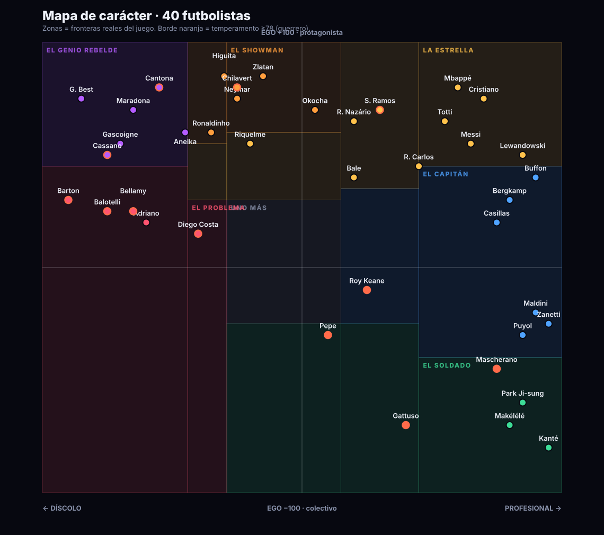

# Perfiles de carácter — referencia de diseño para *La Primera*

Cuarenta futbolistas reales medidos con **los seis rasgos que usa el juego**, colocados en el
mapa de arquetipos y traducidos a mecánica. Este documento es a la vez material de inspiración
y **banco de pruebas**: cuando el sistema clasifica mal a alguien conocido, el sistema está mal.

**Fuentes.** Las historias con ✔ están verificadas en prensa consultada al preparar el
documento. Las que empiezan por ~ vienen de conocimiento general de dominio popular: sirven para
diseñar, pero el fútbol infla las anécdotas y conviene contrastarlas antes de convertirlas en
contenido. Nada de esto atribuye conductas a los compañeros reales que aparecen en el juego:
son situaciones que le pasan **a tu jugador**.

---

## Los seis rasgos

Cada rasgo tiene efecto medible en el motor. Un parámetro sin consecuencia es ruido.

| Rasgo | Rango | Qué controla | Diferencia entre el mínimo y el máximo |
|---|---|---|---|
| **Disciplina** | −100…+100 | Tolerancia del míster, interés de los clubes | castigo ×0,73 → ×1,32 |
| **Ego** | −100…+100 | Aura de grada, prensa, arquetipo | aura ×0,85 → ×1,40 |
| **Temperamento** | 0…100 | Tarjetas, tanganas, entrar al trapo | amarilla 15,8% → 24,3% |
| **Compañerismo** | 0…100 | Asistencias y afinidad de vestuario | asistencia 32,4% → 45,1% |
| **Liderazgo** | 0…100 | Cuánto sube el equipo cuando aciertas | empuje ×1,066 → ×1,155 |
| **Resiliencia** | 0…100 | Confianza perdida tras un mal partido | −7,7 → −4,2 |

Los rasgos **no se eligen**: se llenan con lo que decides. Cada tarjeta sube el temperamento,
cada gesto con un compañero sube el compañerismo, cada asistencia te acerca al perfil generoso.
El contenido también puede moverlos a propósito con las claves `disc`, `ego`, `temp`, `comp`,
`lid`, `res`.

**Disciplina y ego deciden el arquetipo** (el titular de tu personaje). **Los otros cuatro son
la letra pequeña**, y son los que hacen que dos jugadores del mismo cuadrante se sientan
distintos.

---

## Los ocho arquetipos

| Arquetipo | Cómo se entra | Ejemplos de la lista |
|---|---|---|
| **La estrella** | disciplina alta + ego alto | Cristiano, Messi, Mbappé, Lewandowski, Totti |
| **El capitán** | disciplina alta + ego moderado | Maldini, Zanetti, Buffon, Casillas, Puyol |
| **El soldado** | disciplina alta + ego muy bajo | Kanté, Makélélé, Park Ji-sung |
| **El guerrero** | temperamento ≥78 y disciplina no negativa | Roy Keane, Gattuso, Pepe, Mascherano |
| **El showman** | ego muy alto, disciplina floja | Zlatan, Neymar, Higuita, Chilavert, Okocha |
| **El genio rebelde** | disciplina muy baja + ego alto | Maradona, Cantona, Best, Gascoigne |
| **El problema** | disciplina muy baja sin carisma | Balotelli, Barton, Bellamy, Adriano |
| **Uno más** | sin sello todavía | el punto de partida de toda carrera |

---

## Mapa



*(Si no se ve, abre `mapa-caracter.svg` en el navegador.)*

Colocar a los 40 sirvió para cazar un fallo de diseño: la primera versión de las fronteras
erraba en **15 de 40** —llamaba *showman* a Cristiano, a Messi y a Mbappé, y *uno más* a Roy
Keane— porque miraba el ego antes que la disciplina. Corregido. Los 40 caen ahora donde deben.

Lo que enseña el mapa de un vistazo:

- **El cuadrante superior derecho está lleno**: la élite moderna es profesional *y* egocéntrica.
  El juego debe premiar esa combinación, no castigarla.
- **La esquina inferior derecha tiene solo cuatro nombres**: la vía del obrero humilde existe
  pero es minoritaria — y en nuestro juego está claramente infrapremiada.
- **La banda izquierda por debajo de ego 45 es tierra de nadie**: ser díscolo sin carisma no
  tiene recompensa posible. Correcto que sea así.

---

## Tabla completa

| Jugador | Dis | Ego | Tmp | Cmp | Lid | Res | Arquetipo |
|---|---:|---:|---:|---:|---:|---:|---|
| Javier Zanetti | +95 | -25 | 30 | 90 | 92 | 90 | El capitán |
| N'Golo Kanté | +95 | -80 | 15 | 95 | 45 | 85 | El soldado |
| Gianluigi Buffon | +90 | +40 | 55 | 80 | 95 | 90 | El capitán |
| Paolo Maldini | +90 | -20 | 30 | 80 | 90 | 85 | El capitán |
| Robert Lewandowski | +85 | +50 | 40 | 60 | 70 | 90 | La estrella |
| Carles Puyol | +85 | -30 | 65 | 85 | 88 | 85 | El capitán |
| Park Ji-sung | +85 | -60 | 40 | 90 | 50 | 85 | El soldado |
| Dennis Bergkamp | +80 | +30 | 50 | 75 | 60 | 60 | El capitán |
| Claude Makélélé | +80 | -70 | 45 | 85 | 55 | 80 | El soldado |
| Iker Casillas | +75 | +20 | 35 | 85 | 85 | 70 | El capitán |
| Javier Mascherano | +75 | -45 | 80 | 85 | 80 | 85 | El guerrero |
| Cristiano Ronaldo | +70 | +75 | 55 | 40 | 80 | 95 | La estrella |
| Lionel Messi | +65 | +55 | 35 | 90 | 70 | 80 | La estrella |
| Kylian Mbappé | +60 | +80 | 45 | 55 | 65 | 85 | La estrella |
| Francesco Totti | +55 | +65 | 55 | 80 | 85 | 70 | La estrella |
| Roberto Carlos | +45 | +45 | 45 | 70 | 65 | 80 | La estrella |
| Gennaro Gattuso | +40 | -70 | 90 | 80 | 70 | 75 | El guerrero |
| Sergio Ramos | +30 | +70 | 88 | 65 | 90 | 92 | La estrella |
| Roy Keane | +25 | -10 | 92 | 55 | 95 | 80 | El guerrero |
| Ronaldo Nazário | +20 | +65 | 30 | 70 | 60 | 95 | La estrella |
| Gareth Bale | +20 | +40 | 30 | 55 | 40 | 55 | La estrella |
| Pepe | +10 | -30 | 88 | 70 | 60 | 75 | El guerrero |
| Jay-Jay Okocha | +5 | +70 | 30 | 75 | 55 | 60 | El showman |
| Zlatan Ibrahimović | -15 | +85 | 70 | 45 | 75 | 85 | El showman |
| Juan Román Riquelme | -20 | +55 | 40 | 85 | 70 | 45 | La estrella |
| José Luis Chilavert | -25 | +80 | 85 | 40 | 75 | 65 | El showman |
| Neymar | -25 | +75 | 60 | 70 | 55 | 50 | El showman |
| René Higuita | -30 | +85 | 60 | 55 | 65 | 60 | El showman |
| Ronaldinho | -35 | +60 | 25 | 88 | 60 | 55 | El showman |
| Diego Costa | -40 | +15 | 92 | 45 | 55 | 70 | El problema |
| Nicolas Anelka | -45 | +60 | 55 | 35 | 25 | 45 | El genio rebelde |
| Eric Cantona | -55 | +80 | 85 | 60 | 80 | 65 | El genio rebelde |
| Adriano | -60 | +20 | 45 | 60 | 30 | 15 | El problema |
| Diego Maradona | -65 | +70 | 72 | 85 | 92 | 70 | El genio rebelde |
| Craig Bellamy | -65 | +25 | 88 | 40 | 45 | 55 | El problema |
| Paul Gascoigne | -70 | +55 | 75 | 75 | 40 | 25 | El genio rebelde |
| Antonio Cassano | -75 | +50 | 80 | 25 | 20 | 30 | El genio rebelde |
| Mario Balotelli | -75 | +25 | 82 | 45 | 20 | 30 | El problema |
| George Best | -85 | +75 | 55 | 60 | 45 | 30 | El genio rebelde |
| Joey Barton | -90 | +30 | 95 | 30 | 35 | 40 | El problema |

---

# A · Genios rebeldes y talentos autodestruidos

## Diego Maradona
**El genio rebelde** · disciplina -65 · ego +70 · temperamento 72 · compañerismo 85 · liderazgo 92 · resiliencia 70

**Historias**

- ✔ **Los dos Diegos.** Su preparador físico Fernando Signorini y sus compañeros de selección distinguían entre *Diego*, el chaval humilde de la intimidad, y *Maradona*, el personaje público. Ottavio Bianchi, su técnico campeón en el Nápoles, se quedaba con el primero.
- ✔ **No quería entrenar por las mañanas.** Bianchi contó que le costaban las sesiones matinales porque se acostaba tardísimo hablando hasta altas horas.
- ✔ **El castigo que dolía.** Bianchi reveló que lo que de verdad le hacía daño no era una multa: era dejarle sin balón.
- ✔ **El líder que multiplicaba.** Sus excompañeros coinciden en que convertía equipos normales en equipos temidos solo con estar.

**Qué robar**

- **Doble identidad**: quién eres en el vestuario y quién eres en la portada, en dos medidores separados.
- **Castigos que duelen**: apartarte del balón en el rondo en vez de restarte un número.
- **El genio arrastra**: liderazgo alto debería subir a todo el equipo cuando aciertas. (Implementado: `mLider`.)

## Eric Cantona
**El genio rebelde** · disciplina -55 · ego +80 · temperamento 85 · compañerismo 60 · liderazgo 80 · resiliencia 65

**Historias**

- ~ **La patada al aficionado (1995).** Saltó a la grada contra un espectador que le insultó; ocho meses de sanción y trabajo comunitario. El United le mantuvo y fue decisivo al volver.
- ~ **El cuello levantado.** Su arrogancia corporal era exactamente lo que la grada adoraba.
- ~ **Los entrenamientos extra con los jóvenes.** Se quedaba practicando después y la generación del 92 le copió la costumbre.

**Qué robar**

- **La afición te salva o te hunde**: con aura alta el club te respalda tras un escándalo gravísimo.
- **El rebelde que enseña**: mentorizar debería estar disponible también para el díscolo.

## George Best
**El genio rebelde** · disciplina -85 · ego +75 · temperamento 55 · compañerismo 60 · liderazgo 45 · resiliencia 30

**Historias**

- ~ El arquetipo original del futbolista-estrella-de-rock: fama masiva, alcohol y desapariciones antes de partidos.
- ~ Su frase sobre haberse gastado el dinero en coches, mujeres y alcohol y haber malgastado el resto es parte del folclore.

**Qué robar**

- **Declive por fama, no por edad**: que la popularidad tenga un techo peligroso.

## Paul Gascoigne
**El genio rebelde** · disciplina -70 · ego +55 · temperamento 75 · compañerismo 75 · liderazgo 40 · resiliencia 25

**Historias**

- ~ Genio y bufón a partes iguales, con problemas de alcoholismo que él mismo ha hecho públicos.
- ~ La entrada temeraria en la final de FA Cup de 1991 que le destrozó la rodilla: talento saboteado por impulso.

**Qué robar**

- **Decisiones de impulso en momentos grandes** que cuestan la carrera, no solo el partido.
- **Lesión grave como consecuencia de una elección**, no del azar.

## Adriano
**El problema** · disciplina -60 · ego +20 · temperamento 45 · compañerismo 60 · liderazgo 30 · resiliencia 15

**Historias**

- ~ Delantero descomunal en el Inter cuya carrera se quiebra tras la muerte de su padre; él mismo ha hablado de cómo perdió la motivación.

**Qué robar**

- **Golpes vitales ajenos al deporte** que alteran atributos y ánimo: una vida personal con sucesos que no controlas.

## Juan Román Riquelme
**La estrella** · disciplina -20 · ego +55 · temperamento 40 · compañerismo 85 · liderazgo 70 · resiliencia 45

**Historias**

- ~ Choque famoso con Van Gaal en el Barça, que no encontraba sitio para un jugador que imponía su propio tempo.
- ~ Reivindicado como ídolo absoluto en Boca.

**Qué robar**

- **Incompatibilidad táctica**: que un técnico no crea en tu perfil aunque tu media sea alta, y que cambiar de club lo arregle.

## Antonio Cassano
**El genio rebelde** · disciplina -75 · ego +50 · temperamento 80 · compañerismo 25 · liderazgo 20 · resiliencia 30

**Historias**

- ~ Sus broncas con directivos y entrenadores en Roma, Madrid y Milan son legendarias; el término *cassanata* se acuñó para describirlas.

**Qué robar**

- **Nombre propio en la prensa**: cuando repites un tipo de escándalo, los medios le ponen etiqueta y te persigue de club en club.

# B · El problema

## Mario Balotelli
**El problema** · disciplina -75 · ego +25 · temperamento 82 · compañerismo 45 · liderazgo 20 · resiliencia 30

**Historias**

- ✔ **Los fuegos artificiales.** La víspera del derbi de Mánchester de 2011 los lanzó dentro de su casa y tuvieron que evacuarle los bomberos. Al día siguiente marcó dos goles en el 6-1 al United y enseñó la camiseta del *Why Always Me?*.
- ✔ **Embajador de seguridad pirotécnica.** El club le dio ese título como castigo por lo anterior.
- ✔ **Sustituido a los 30 minutos.** En un amistoso de 2011 intentó un remate imposible de tacón, falló a puerta vacía y Mancini le retiró en el acto.
- ✔ **Multa de una semana de sueldo** por lanzar dardos a jugadores del filial.
- ✔ **Quién le entendía.** Señala a Mancini y a Prandelli como los técnicos que supieron llevarle con la dosis justa de libertad.

**Qué robar**

- **Cadena de escándalo**: lío fuera del campo → titular → castigo del club → presión en el siguiente partido, que puede acabar en partidazo de rabia.
- **El técnico que te entiende**: que el míster tenga carácter propio y tolere o rechace el tuyo.
- **Castigos creativos** en lugar de multas genéricas.

## Joey Barton
**El problema** · disciplina -90 · ego +30 · temperamento 95 · compañerismo 30 · liderazgo 35 · resiliencia 40

**Historias**

- ~ Carrera marcada por sanciones deportivas y condenas fuera del campo: el talento nunca compensó del todo el coste.

**Qué robar**

- **Suspensiones largas** que te apartan meses, y clubes que directamente te vetan.

## Nicolas Anelka
**El genio rebelde** · disciplina -45 · ego +60 · temperamento 55 · compañerismo 35 · liderazgo 25 · resiliencia 45

**Historias**

- ~ Apodado *Le Sulk* por la prensa inglesa; doce clubes con salidas conflictivas.
- ~ El enfrentamiento con Domenech en el Mundial 2010 acabó con su expulsión y un motín de la plantilla.

**Qué robar**

- **El motín de vestuario**: con afinidad alta y relación pésima con el míster, poder arrastrar al grupo contra él. Puede acabar con el técnico despedido… o contigo fuera.

## Craig Bellamy
**El problema** · disciplina -65 · ego +25 · temperamento 88 · compañerismo 40 · liderazgo 45 · resiliencia 55

**Historias**

- ~ Su paso por múltiples clubes viene acompañado de choques con entrenadores y compañeros.

**Qué robar**

- **Historial que viaja contigo**: los clubes consultan tu expediente y bajan sus ofertas. (Implementado: `interesClubes`; falta mostrarlo.)

## Diego Costa
**El problema** · disciplina -40 · ego +15 · temperamento 92 · compañerismo 45 · liderazgo 55 · resiliencia 70

**Historias**

- ~ Su juego se basaba en sacar de quicio a los centrales rivales durante noventa minutos.

**Qué robar**

- **Provocar al rival como táctica**: opciones cuyo efecto no es tu gol sino la amarilla del contrario.

## Pepe
**El guerrero** · disciplina +10 · ego -30 · temperamento 88 · compañerismo 70 · liderazgo 60 · resiliencia 75

**Historias**

- ~ Defensa de entrega absoluta y episodios muy sancionados, adorado por su afición justo por lo que le criticaban fuera.

**Qué robar**

- **La grada propia perdona lo que la ajena castiga**: dos medidores de imagen separados.

# C · Showman

## Ronaldinho
**El showman** · disciplina -35 · ego +60 · temperamento 25 · compañerismo 88 · liderazgo 60 · resiliencia 55

**Historias**

- ~ **La ovación del Bernabéu (2005).** El estadio rival le aplaudió de pie: el reconocimiento del enemigo como cumbre de una carrera.
- ~ **La sonrisa como método.** Sus compañeros repiten que entrenaba jugando y contagiaba alegría a un vestuario tocado.
- ~ **La vida nocturna.** Su declive prematuro se atribuye a que la fiesta se comió sus mejores años.

**Qué robar**

- **La ovación del rival** como logro máximo del showman, equivalente al título para el capitán.
- **El coste diferido**: la fiesta no penaliza hoy, penaliza tres temporadas después.

## Neymar
**El showman** · disciplina -25 · ego +75 · temperamento 60 · compañerismo 70 · liderazgo 55 · resiliencia 50

**Historias**

- ~ El regate como declaración de intenciones y una relación con prensa y redes que amplifica todo lo que hace.

**Qué robar**

- **Redes sociales con efecto real**: cada publicación sube fama y expone más tus errores.

## René Higuita
**El showman** · disciplina -30 · ego +85 · temperamento 60 · compañerismo 55 · liderazgo 65 · resiliencia 60

**Historias**

- ~ El escorpión en Wembley (1995) es el gesto showman definitivo.
- ~ También el error de salida en el Mundial 90 contra Camerún que costó la eliminación.

**Qué robar**

- **Jugadas de altísimo riesgo del portero**: salir a jugar como un central, rematar el último córner, el escorpión. Gloria o ridículo histórico.

## Jay-Jay Okocha
**El showman** · disciplina +5 · ego +70 · temperamento 30 · compañerismo 75 · liderazgo 55 · resiliencia 60

**Historias**

- ~ Su nombre se volvió sinónimo de regate imposible; los aficionados del Bolton coreaban que era tan bueno que le pusieron el nombre dos veces.

**Qué robar**

- **El cántico propio**: con ego y aura altos, la grada te dedica un cántico. Hito equivalente al brazalete.

## Roberto Carlos
**La estrella** · disciplina +45 · ego +45 · temperamento 45 · compañerismo 70 · liderazgo 65 · resiliencia 80

**Historias**

- ~ El libre imposible contra Francia en 1997 definió su carrera entera: un lateral recordado por una jugada de balón parado.

**Qué robar**

- **La jugada firma**: una habilidad al nivel 99 debería tener narración propia.

## José Luis Chilavert
**El showman** · disciplina -25 · ego +80 · temperamento 85 · compañerismo 40 · liderazgo 75 · resiliencia 65

**Historias**

- ~ Portero que lanzaba faltas y penaltis y acumuló decenas de goles, con fama de carácter difícil.

**Qué robar**

- **Romper el rol de tu puesto**: que un portero pueda entrenar tiros libres y llegar a lanzarlos.

# D · Estrellas

## Zlatan Ibrahimović
**El showman** · disciplina -15 · ego +85 · temperamento 70 · compañerismo 45 · liderazgo 75 · resiliencia 85

**Historias**

- ✔ **El Ferrari.** Guardiola le avisó de que al Barça no se iba en deportivos. Zlatan lo leyó como un «no te creas especial» y aceptó el Audi del club, pero fue el principio del desencuentro.
- ✔ **La caja metálica.** Tras ser suplente contra el Villarreal estalló en el vestuario, golpeó una caja y le gritó a Guardiola que no tenía valor. El técnico no contestó.
- ✔ **Capello le reprogramó.** En la Juve le repetía a diario que iba a quitarle todo el Ajax del cuerpo para convertirlo en goleador: se acabaron los túneles.
- ✔ **El SMS de Mourinho.** Antes de conocerse le mandó un mensaje felicitándole tras un partido de la Euro 2008. Zlatan dice que nunca había recibido un SMS de un entrenador.
- ✔ **«Me voy al Barcelona a ganar la Champions.»** Lo anunció en el vestuario del Inter; Mourinho contó que respondió que quizá se fuera y ganaran igual. Ganaron el triplete.

**Qué robar**

- **Relación con el entrenador con personalidad**: el mismo jugador rinde distinto según quién le dirija.
- **Estilo contra resultados**: aceptar dejar las florituras sube disciplina y goles; negarte sube ego.

## Cristiano Ronaldo
**La estrella** · disciplina +70 · ego +75 · temperamento 55 · compañerismo 40 · liderazgo 80 · resiliencia 95

**Historias**

- ✔ **Tévez se rindió.** Llegaba a las 7:30 y Cristiano ya estaba en el gimnasio; probó a las 7:00 y a las 6:45, y siempre estaba antes.
- ✔ **La mesa de ping-pong.** Evra cuenta que perdió contra Ferdinand, mandó comprar una mesa, entrenó dos semanas y volvió a ganarle delante de todos.
- ✔ **El postre.** Alex Telles contaba que sus comidas eran distintas y que a los compañeros les daba reparo ir a por postre.
- ✔ **Gimnasio a las once de la noche.** Benatia relató que le invitó a entrenar de noche volviendo de un partido en el que ambos fueron suplentes.
- ✔ **La segunda etapa en el United.** Mike Phelan dijo que volvió más obstinado, con estándares altísimos, queriendo subir el nivel de los demás — y que ahí se pierde a gente.

**Qué robar**

- **La exigencia contagia o divide**: subir el nivel del grupo sube la media del equipo y baja la afinidad con quien no sigue el ritmo.
- **Entrenamiento invisible**: sesiones que nadie te pide. (Implementado: sesión extra.)
- **El ego rentable**: ego alto + disciplina alta debe ser el perfil más productivo, no un castigo.

## Lionel Messi
**La estrella** · disciplina +65 · ego +55 · temperamento 35 · compañerismo 90 · liderazgo 70 · resiliencia 80

**Historias**

- ~ Durante años se le reprochó no ser un líder vocal; el liderazgo llegó con la edad y de forma distinta a la del capitán clásico.

**Qué robar**

- **Liderazgo sin hablar**: una vía de autoridad basada en rendimiento acumulado, no en decisiones de vestuario.

## Kylian Mbappé
**La estrella** · disciplina +60 · ego +80 · temperamento 45 · compañerismo 55 · liderazgo 65 · resiliencia 85

**Historias**

- ~ Su trayectoria está marcada por decisiones de despacho tomadas con enorme frialdad desde muy joven.

**Qué robar**

- **Poder de negociación creciente**: con media y fama altas, poder exigir lo que a otro le costaría la oferta.

## Gareth Bale
**La estrella** · disciplina +20 · ego +40 · temperamento 30 · compañerismo 55 · liderazgo 40 · resiliencia 55

**Historias**

- ~ La bandera con el orden de sus prioridades resume un final de etapa sin compromiso pero con rendimiento cuando jugaba.

**Qué robar**

- **Desconexión**: estado en el que cumples pero has dejado de importarte el club. Nota decente, cero vestuario, la afición encima.

## Robert Lewandowski
**La estrella** · disciplina +85 · ego +50 · temperamento 40 · compañerismo 60 · liderazgo 70 · resiliencia 90

**Historias**

- ~ Longevidad basada en control extremo de alimentación y preparación, con equipo personal propio.

**Qué robar**

- **Equipo personal**: contratar preparador o nutricionista con tu dinero. Mejora atributos y frena el declive, pero cuesta y al club puede no gustarle.

# E · Capitanes y líderes

## Roy Keane
**El guerrero** · disciplina +25 · ego -10 · temperamento 92 · compañerismo 55 · liderazgo 95 · resiliencia 80

**Historias**

- ✔ **La venganza sobre Haaland.** Reconoció en su autobiografía haberle roto la pierna intencionadamente y dijo que de eso no se arrepiente.
- ✔ **Nunca más pidió una camiseta.** Contó en el pódcast de Gary Neville que se la pidió a Sammer tras un amistoso de 1994, este dijo que no, y no volvió a pedir ninguna.
- ✔ **Su idea de liderazgo.** Criticando la dimisión de Maldini y Leonardo del Milan dijo que un líder, tomada la decisión, sigue adelante en vez de tirar los juguetes.

**Qué robar**

- **El guerrero como arquetipo**: profesional impecable y bestia en el campo. (Implementado.)
- **Liderazgo incómodo**: decisiones que suben tu autoridad y hunden tu afinidad.
- **Crítica pública a los tuyos** como opción de rueda de prensa, con consecuencias graves.

## Paolo Maldini
**El capitán** · disciplina +90 · ego -20 · temperamento 30 · compañerismo 80 · liderazgo 90 · resiliencia 85

**Historias**

- ~ **La autoridad sin gritos.** Gattuso ha contado que era el único al que respetaba sin discutir y que bastaba una mirada suya para frenarle.
- ~ **Veinticinco años en el mismo club** y capitán durante más de una década: la permanencia como forma de liderazgo.
- ✔ **La referencia moral.** Se le cita como modelo de capitán honesto y ejemplar junto a Zanetti y Puyol.

**Qué robar**

- **La mirada que ordena**: desactivar a un compañero descontrolado sin decir nada. Exclusiva de disciplina alta.
- **Fidelidad al club** con recompensa real: leyenda, dorsal retirado, cargo al retirarte.

## Carles Puyol
**El capitán** · disciplina +85 · ego -30 · temperamento 65 · compañerismo 85 · liderazgo 88 · resiliencia 85

**Historias**

- ✔ **«La palabra convence, pero el ejemplo empuja.»** Su definición de liderazgo: el esfuerzo es innegociable.
- ✔ **El consejo de su padre.** Al irse a probar al Barça le dijo que si volvía habiéndolo dado todo no pasaba nada, pero que si volvía sin darlo todo se arrepentiría siempre.
- ✔ **El ego como peligro.** Dice que tras ganar aparecen los egos y que si alguien quiere ir en otra dirección, lo mejor es que salga del equipo.
- ✔ **Ganar después de ganar.** Señala que lo difícil es lo segundo, porque se piensa que el siguiente título será fácil.

**Qué robar**

- **El vestuario como recurso**: el capitán puede echar moralmente a un díscolo. Si el díscolo eres tú, esa presión debe llegarte.
- **Complacencia tras el éxito**: penalización la temporada siguiente a ganar algo, salvo que decidas evitarlo.

## Javier Zanetti
**El capitán** · disciplina +95 · ego -25 · temperamento 30 · compañerismo 90 · liderazgo 92 · resiliencia 90

**Historias**

- ~ Casi dos décadas en el Inter con regularidad y conducta intachables; hoy vicepresidente del club.

**Qué robar**

- **Carrera post-retirada**: quedarte como directivo o entrenador, final exclusivo de disciplina muy alta.

## Iker Casillas
**El capitán** · disciplina +75 · ego +20 · temperamento 35 · compañerismo 85 · liderazgo 85 · resiliencia 70

**Historias**

- ~ Capitán y símbolo que acabó suplente y enfrentado al entorno del club, con una despedida dolorosa pese a los títulos.

**Qué robar**

- **La caída del ídolo**: que un capitán veterano pueda ser apartado por un técnico nuevo y que la afición se divida.

## Gianluigi Buffon
**El capitán** · disciplina +90 · ego +40 · temperamento 55 · compañerismo 80 · liderazgo 95 · resiliencia 90

**Historias**

- ~ Tras el descenso administrativo de la Juventus en 2006 se quedó en Serie B pudiendo irse a cualquier grande.

**Qué robar**

- **Lealtad en la crisis**: si tu club desciende, quedarte otorga un estatus de leyenda imposible de lograr de otro modo.

## Sergio Ramos
**La estrella** · disciplina +30 · ego +70 · temperamento 88 · compañerismo 65 · liderazgo 90 · resiliencia 92

**Historias**

- ~ Récord de expulsiones y a la vez goles decisivos en los minutos finales de finales históricas: el mismo carácter produce las dos cosas.

**Qué robar**

- **El héroe en el descuento**: opciones extra en los últimos diez minutos con probabilidades altísimas y riesgo de roja igual de alto.

## Francesco Totti
**La estrella** · disciplina +55 · ego +65 · temperamento 55 · compañerismo 80 · liderazgo 85 · resiliencia 70

**Historias**

- ~ Rechazó ofertas de grandes europeos para quedarse toda su carrera en la Roma, ganando mucho menos de lo que pudo.

**Qué robar**

- **Contador de fidelidad**: cada oferta rechazada suma a un medidor de leyenda local que desbloquea final propio, cánticos y estatua.

# F · Soldados y guerreros

## Gennaro Gattuso
**El guerrero** · disciplina +40 · ego -70 · temperamento 90 · compañerismo 80 · liderazgo 70 · resiliencia 75

**Historias**

- ~ **Solo respetaba al capitán.** En el Milan estaba en guerra con medio campo, incluido el árbitro, y solo se frenaba ante Maldini.
- ~ **El perro de presa.** Su valor no eran los goles sino morder tobillos y sostener al equipo por detrás.

**Qué robar**

- **Valor sin estadísticas**: nota alta por recuperaciones y faltas útiles, no por goles.
- **Lealtad a una figura**: elegir a un compañero como referencia y notar su marcha.

## N'Golo Kanté
**El soldado** · disciplina +95 · ego -80 · temperamento 15 · compañerismo 95 · liderazgo 45 · resiliencia 85

**Historias**

- ✔ **El Mini con el retrovisor pegado con cinta.** Llegaba al entrenamiento del Chelsea en un Mini de segunda mano mientras desfilaban los Ferraris; Hazard le apodó *The Rat*. Dice que de joven nunca tuvo la ambición de tener coche.
- ✔ **La multa que no quiso pagar.** Vardy contó que se negó a pagar una sanción por llegar tarde porque prefería destinar ese dinero a ayudar a gente en África.
- ✔ **La noche con desconocidos.** Perdió el Eurostar a París, buscó la mezquita más cercana y acabó cenando curry y jugando al FIFA con unos aficionados.
- ✔ **Los quince pulmones.** Pogba bromeaba con que debía tener quince pulmones porque no se explicaba cómo podía correr tanto.

**Qué robar**

- **La humildad como estadística**: ego muy negativo debe dar bonus reales — afinidad disparada, el míster te defiende, la afición te adopta. Hoy la vía humilde está infrapremiada.

## Claude Makélélé
**El soldado** · disciplina +80 · ego -70 · temperamento 45 · compañerismo 85 · liderazgo 55 · resiliencia 80

**Historias**

- ~ Su marcha del Madrid en 2003 se considera el inicio del declive de aquel equipo; su función era tan invisible que solo se notó cuando faltó.

**Qué robar**

- **El valor que solo se ve cuando faltas**: si el soldado se lesiona, el equipo debe caer visiblemente y la prensa señalarlo.

## Park Ji-sung
**El soldado** · disciplina +85 · ego -60 · temperamento 40 · compañerismo 90 · liderazgo 50 · resiliencia 85

**Historias**

- ~ Ferguson lo reservaba para los partidos importantes con una misión concreta: anular a un rival determinado.

**Qué robar**

- **Misión personal en partidos grandes**: secar a una estrella rival. Si cumples, tu nota sube aunque no toques el balón en ataque.

## Javier Mascherano
**El guerrero** · disciplina +75 · ego -45 · temperamento 80 · compañerismo 85 · liderazgo 80 · resiliencia 85

**Historias**

- ~ Reconvertido de mediocentro a central en el Barça, aceptó el cambio de puesto por el equipo.

**Qué robar**

- **Cambio de posición a mitad de carrera**: rechazarlo cuesta relación, aceptarlo reinicia parte de tus atributos y abre otro árbol de habilidades.

# G · Casos que abren mecánicas nuevas

## Dennis Bergkamp
**El capitán** · disciplina +80 · ego +30 · temperamento 50 · compañerismo 75 · liderazgo 60 · resiliencia 60

**Historias**

- ✔ **El miedo a volar.** Tras una mala experiencia en aviones pequeños desarrolló claustrofobia y dejó de volar. Se perdía partidos fuera de Inglaterra y llegó a cobrar menos del Arsenal por esa indisponibilidad. Lo cuenta en su autobiografía.
- ✔ **Contraste útil:** Iván Helguera tuvo el mismo miedo y lo resolvió viajando en cabina con los pilotos.

**Qué robar**

- **Rasgos personales con consecuencia contractual**: una fobia o condición que te haga indisponible en cierto tipo de partidos, con el salario ajustado. Un defecto que no es una estadística.

## Ronaldo Nazário
**La estrella** · disciplina +20 · ego +65 · temperamento 30 · compañerismo 70 · liderazgo 60 · resiliencia 95

**Historias**

- ~ Dos roturas gravísimas de rodilla y un regreso que culminó con el Mundial 2002: una lesión terrible no tiene por qué ser el final.

**Qué robar**

- **Rehabilitación jugable**: meses fuera con decisiones semanales (forzar el ritmo, ser prudente, cambiar de médico), atributos que caen y un retorno que puede ser gloria o recaída.

---

# Hoja de ruta que sale de los 40

Ordenada por lo que más cambiaría el juego.

1. **El entrenador con personalidad propia.** Balotelli-Mancini, Zlatan-Guardiola,
   Riquelme-Van Gaal, Casillas-Mourinho. La misma decisión debe salir bien con un técnico y
   fatal con otro. Es lo que más separa este juego de un simulador genérico.
2. **Rehabilitación jugable** (Ronaldo Nazário, Gascoigne). Convertir la lesión en contenido
   con decisiones semanales, en vez de en jornadas descontadas.
3. **Coste diferido de la vida disipada** (Best, Adriano, Gascoigne, Ronaldinho). La juerga se
   paga tres temporadas después, no el lunes. Es lo que hace trágicas esas carreras.
4. **Premiar de verdad el ego bajo** (Kanté, Makélélé, Park). Hoy la vía humilde rinde menos que
   la del showman, y el mapa demuestra que es un camino legítimo de élite.
5. **Cambio de posición a mitad de carrera** (Mascherano). Alarga carreras y reinicia el árbol
   de habilidades.
6. **El valor que solo se ve cuando faltas** (Makélélé). Si el soldado se lesiona, el equipo cae
   visiblemente y la prensa lo señala.
7. **Misión personal en partidos grandes** (Park Ji-sung). Secar a una estrella rival: nota alta
   sin tocar el balón en ataque.
8. **Contador de fidelidad** (Totti, Buffon, Zanetti, Maldini). Cada oferta rechazada construye
   un final de partida propio: leyenda local, estatua, cargo en el club.
9. **Dos medidores de imagen: tu afición y la opinión pública** (Pepe, Cantona). Lo que una
   perdona, la otra lo castiga.
10. **Rasgos personales con efecto contractual** (Bergkamp). Una fobia o condición que te haga
    indisponible, con el salario ajustado. Un defecto que no es una estadística.
11. **El motín de vestuario** (Anelka). Con afinidad alta y relación pésima con el míster,
    poder tumbar al entrenador… o caer tú.
12. **El cántico propio y la jugada firma** (Okocha, Roberto Carlos). Hitos de identidad, no de
    estadística: la habilidad a nivel 99 merece narración propia.
13. **Provocar al rival como táctica** (Diego Costa). Opciones cuyo efecto es la amarilla del
    contrario, no tu gol.
14. **La ovación del rival** (Ronaldinho). El trofeo del showman, equivalente al título para el
    capitán.

---

# Los problemas personales: cómo encajan (propuesta)

## La tesis: un vicio no es un rasgo

Un rasgo es estable: el temperamento de Gattuso era el mismo a los 22 que a los 34. Una adicción
es **un proceso con fases**, que empieza siendo invisible, da una ilusión de beneficio y cobra
tarde. Meterla como séptimo rasgo la aplanaría; hay que modelarla como sistema aparte.

Los seis rasgos ya tenemos no describen el problema: **describen la vulnerabilidad a tenerlo**.

## 1. Vulnerabilidad — se calcula, no se añade

```
vulnerabilidad = (100 − disciplina_normalizada) × 0,35
               + (100 − resiliencia)            × 0,35
               + ego                            × 0,15
               + fama                           × 0,15
```

Sin inventar ejes nuevos. Y explica a los 40: Best (disciplina −85, resiliencia 30, ego 75) sale
disparado; Kanté (disciplina 95, resiliencia 85, ego −80) es prácticamente inmune. Maradona,
Gascoigne y Adriano están todos en la zona roja por la misma combinación: **poca disciplina y
poca resiliencia**. Cristiano tiene ego 75 y fama máxima, pero disciplina 70 y resiliencia 95
lo blindan. Es exactamente lo que pasó en la realidad.

## 2. Detonantes — la puerta no se abre sola

El medidor no sube por existir. Necesita un suceso, y aquí conectamos con la vida personal:

| Detonante | Ejemplo real | Qué abre |
|---|---|---|
| **Golpe vital** (muerte, ruptura) | Adriano y su padre | alcohol |
| **Explosión de fama** | George Best | noche |
| **Lesión larga** | Gascoigne | alcohol, analgésicos |
| **Banquillo prolongado** | — | noche, desconexión |
| **Dinero repentino** | primer contrato grande | noche, juego |
| **Presión insoportable** | Maradona en Nápoles | sustancias |

## 3. El medidor: cuatro fases, y la trampa está en la primera

Cada vicio (`noche`, `alcohol`, `sustancias`, `juego`) tiene su medidor 0-100 **oculto para el
jugador**, y avanza según tus decisiones y tu vulnerabilidad.

| Fase | Qué siente el jugador | Qué pasa de verdad |
|---|---|---|
| **0-25 · ocasional** | nada | nada |
| **25-50 · habitual** | **te sientes mejor**: +confianza, +ánimo, algún partidazo | la forma empieza a caer y aparece el primer titular |
| **50-75 · dependencia** | los partidos se te hacen raros | atributos bajando cada jornada, el míster sospecha, la prensa huele |
| **75-100 · crisis** | todo se rompe a la vez | control positivo, ingreso, sanción larga, rescisión |

**La fase 25-50 es la clave del diseño.** Si la juerga restara desde el primer día, nadie la
elegiría y el sistema sería un impuesto. Tiene que dar lo que da en la realidad: **sensación de
estar mejor mientras te vacía por debajo**. El coste llega con retraso de varias jornadas — la
mecánica del *coste diferido* que ya identificamos con Best y Ronaldinho.

## 4. Las salidas tienen que existir y costar

- **El compañero que te saca.** Con afinidad alta, alguien del vestuario te encara. Aceptar su
  ayuda baja el medidor; mandarle a paseo lo sube y te cuesta la relación.
- **El club interviene.** Tratamiento: te pierdes media temporada, bajas el medidor a la mitad,
  y el club lo mantiene en secreto… o se filtra.
- **La recaída.** Bajar el medidor no lo borra: queda un suelo. Volver a caer es más fácil que la
  primera vez, y eso es lo que hace tan dura la historia de Gascoigne.

## 5. Dopaje: la rama del atajo

Es el caso que pediste de «cosas ilegales que ayudan a subir más rápido». Va aparte porque su
lógica es distinta:

- Sube **físico y recuperación** a un ritmo imposible de entrenar.
- Tiene su propio medidor: **riesgo de control**, que crece con tus buenas actuaciones (a más
  brillas, más te controlan).
- El positivo no es una sanción más: **te parte la carrera en dos**. Uno o dos años fuera, la
  media se hunde con la edad, y tu reputación queda marcada para siempre en las ofertas.
- Y una decisión previa que es la de verdad: quién te lo ofrece. Un médico del club, un
  preparador externo, un compañero. Con las tres puertas hay consecuencias distintas si se sabe.

## 6. Los 40, situados

| Jugador | Vicio | Detonante | Fase máxima alcanzada |
|---|---|---|---|
| Maradona | sustancias | presión y fama en Nápoles | crisis |
| George Best | noche + alcohol | fama temprana | crisis |
| Gascoigne | alcohol | lesión y carácter | crisis |
| Adriano | alcohol | muerte del padre | crisis |
| Ronaldinho | noche | éxito absoluto | dependencia |
| Neymar | fiesta | fama y entorno | habitual |
| Balotelli | ninguno claro | — | conducta, no adicción |
| Cristiano, Kanté, Maldini | — | — | inmunes por rasgos |

## 7. La línea que no cruzaría

Ni moralina ni glamour. El juego no debe sermonearte cuando eliges salir de noche, pero tampoco
convertir la adicción en un truco optimizable con coste conocido. Por eso el medidor va oculto:
la trampa consiste precisamente en que **no sabes en qué fase estás** hasta que alguien te lo
dice. Y por eso la salida tiene que estar siempre disponible y ser digna, no un castigo. Si el
jugador acaba retirándose a los 31 sin saber muy bien cuándo se torció, el sistema habrá contado
bien la historia que cuentan Best, Gascoigne y Adriano.
